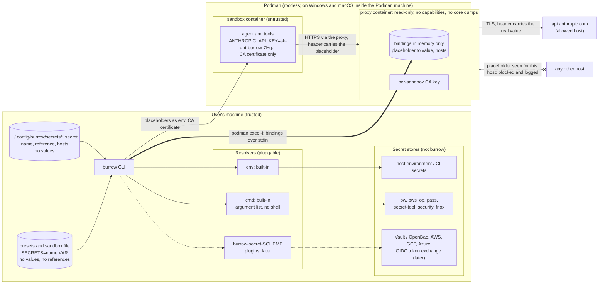
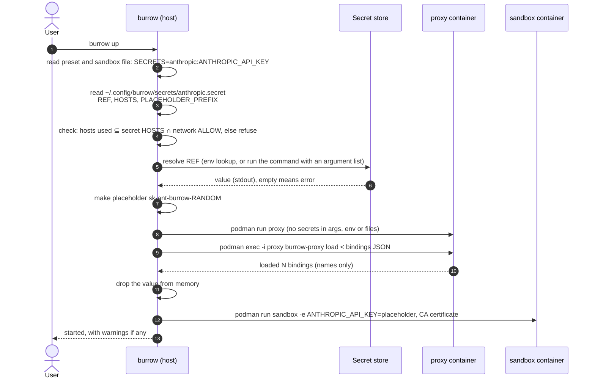
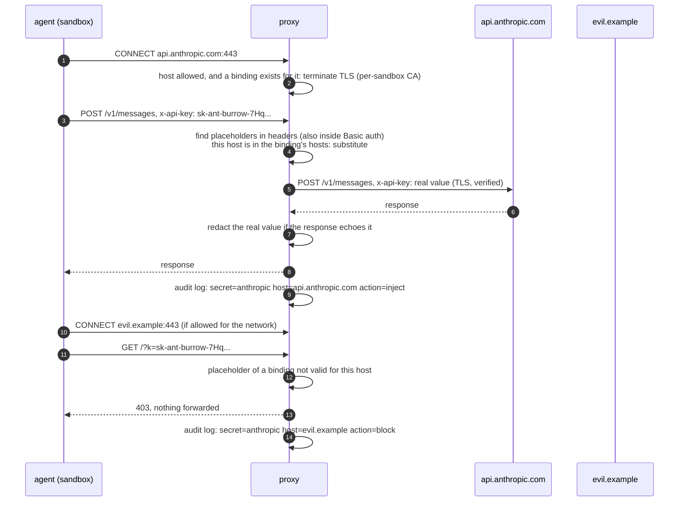
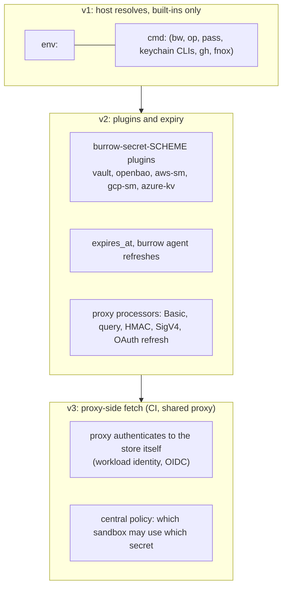

# Secrets

**Status:** design, not built ([decision 0012](decisions/0012-secrets-through-the-proxy.md)).
Serves R7 and D4; controls IAC-14.3, IAC-23, IAC-30, NET-04, AAT-39.6, AAT-39.11, AAT-40.1
(SCF is credited as in secure-standard-platforms' NOTICE.md).

The rule in one line: **the sandbox only ever holds a placeholder. The real value lives in the
user's secret store, is fetched by burrow on the host, and exists at run time only in the memory of
that sandbox's proxy, which puts it into requests to the hosts it is bound to.**

## Concepts

| Term | What it is | Who writes it | Holds a value? |
|---|---|---|---|
| **Secret store** | where the value lives: an environment variable, a password manager (Bitwarden, 1Password, pass), the OS keychain, later Vault/OpenBao or a cloud secret manager | the user or the organisation | yes |
| **Reference** | how to fetch one value from a store: `env:ANTHROPIC_API_KEY`, `cmd:bw get password anthropic` | the user, in their secrets file | no |
| **Secret definition** | a name, its reference, the hosts it may be sent to (the ceiling), an optional placeholder prefix | the user, in `~/.config/burrow/secrets/NAME.secret` | no |
| **Use** | "this preset or sandbox needs secret `NAME` as variable `VAR`" | the preset author or the sandbox file | no |
| **Placeholder** | a random string the sandbox sees in place of the value, unique per secret and per sandbox: `<prefix>burrow-<32 random base62>` | burrow, at start | no |
| **Binding** | placeholder → value, allowed hosts, where to substitute. Built by burrow, held only by the proxy | burrow | yes, in the proxy's memory |
| **Resolver** | the code in burrow that turns a reference into a value: built-in `env` and `cmd`, later plugins | burrow | in memory, briefly |

A preset says **what** it needs and never **where** the value comes from; the user's file says
where it comes from and **how far it may go**. A preset can never run a command on the host or
widen the hosts a secret reaches.

## Architecture



Trust boundaries: the host and the user's files are trusted; the proxy is trusted with the values
of its own sandbox only; the sandbox (agent and tools) is the attacker. Each sandbox and each tool
run (`burrow exec`) has its own proxy (as today), so each has its own bindings: a tool gets only
the secrets its preset declares, never the sandbox's.

## Flow 1: starting a sandbox



The value never appears in a podman argument, an environment variable of any container, a podman
secret, a file or a log. `--dry-run` prints the commands with placeholders and secret names only.

## Flow 2: a request from the sandbox



Hosts without a binding are tunnelled as today (no TLS termination), so the CA is used only where
a secret needs it. The placeholder is worthless outside this proxy: it is random, per sandbox, and
dies with the proxy.

## Flow 3: refresh, rotation and stop

| Event | v1 (initial) | Later |
|---|---|---|
| Value changed in the store | `burrow secrets refresh [SANDBOX]` resolves again and loads new bindings into the running proxy; placeholders stay the same, so the agent notices nothing | values with an expiry (plugin returns `expires_at`): a host-side `burrow agent` refreshes before expiry; or the proxy fetches itself (v3) |
| Revoke now | `burrow secrets revoke NAME [SANDBOX]` drops the binding: the next request with its placeholder is blocked | the same, plus central revocation from a shared policy service (G5) |
| `burrow down` | the proxy container is removed, the bindings go with its memory | – |
| Short-lived tokens | not in v1 (use the store's own short-lived tokens through `cmd`, such as `gh auth token`) | OIDC/STS token exchange, OAuth refresh, SigV4/HMAC re-signing as proxy processors |

## Definitions (proposed format)

Same `KEY=VALUE` format as presets ([DEFINITIONS.md](DEFINITIONS.md)): data, no expansion, unknown
keys are errors.

**Secret definition**, one file per secret in the user's config folder (`burrow secrets` prints
it; never the workspace). Holds no value, so it need not be secret, but burrow refuses one that
others can write.

```
# ~/.config/burrow/secrets/anthropic.secret
NAME=anthropic
REF=cmd:bw get password burrow/anthropic
HOSTS=api.anthropic.com
PLACEHOLDER_PREFIX=sk-ant-
```

| Key | Meaning |
|---|---|
| `NAME` | 2 to 32 of `a-z`, `0-9`, `-`; must match the file name |
| `REF` | `env:VAR` (from burrow's own environment) or `cmd:PROGRAM ARG...` (split on spaces, no shell, no quoting; for anything harder, a script of your own). Later: `SCHEME:...` handled by a plugin |
| `HOSTS` | where the value may be sent, same matching as `ALLOW` (whole labels, `*.domain`). The ceiling: a use can only narrow it |
| `PLACEHOLDER_PREFIX` | optional, for clients that check the format (`sk-ant-`, `ghp_`, `glpat-`). Letters, digits, `-`, `_` |

**Use**, in a preset or sandbox file:

```
SECRETS=anthropic:ANTHROPIC_API_KEY,github:GH_TOKEN
```

burrow refuses to start when a used secret has no definition, when a definition's hosts are not
covered by the network allowlist, or when the reference resolves to an empty value. Under strict
mode a tool may only use secrets its sandbox also uses.

## Recommended backends for v1

| Where you keep secrets | `REF` |
|---|---|
| Bitwarden (the organisation's proposed password manager, IAC-15.2) | `cmd:bw get password ITEM` (needs `BW_SESSION`), or Bitwarden Secrets Manager `cmd:bws secret get ID` with output handled by a small script |
| 1Password | `cmd:op read op://VAULT/ITEM/FIELD` |
| pass / gopass | `cmd:pass show burrow/anthropic` |
| macOS Keychain | `cmd:security find-generic-password -s burrow-anthropic -w` |
| Linux Secret Service (GNOME Keyring, KWallet) | `cmd:secret-tool lookup service burrow name anthropic` |
| GitHub CLI's own login | `cmd:gh auth token` |
| Many stores at once | `cmd:fnox get KEY` with fnox's config outside the workspace (see the decision) |
| CI | `env:NAME`, filled by the CI system's secret store or OIDC step |

Windows Credential Manager has no stock CLI that prints a password; on Windows use Bitwarden,
1Password or fnox (*gap*).

## The resolver contract and plugins (later)

Every resolver, built-in or plugin, does one thing: given a reference, return a value and,
optionally, when it expires. Go interface inside burrow:

```go
type Resolver interface {
    // Resolve returns the value for ref. An empty value is an error.
    Resolve(ctx context.Context, ref string) (Secret, error)
}

type Secret struct {
    Value     []byte
    ExpiresAt time.Time // zero: no expiry known
}
```

A **plugin** is an executable `burrow-secret-SCHEME` found only in the user's plugins folder (not
`PATH`, not the workspace), called with no arguments, JSON on stdin and stdout, the same shape as
Docker credential helpers, git credential helpers and Podman's `shell` secret driver:

```json
{"version": 1, "action": "get", "ref": "vault:kv/data/anthropic#api_key"}
{"value": "...", "expires_at": "2026-11-23T12:00:00Z"}
```

That lets Vault/OpenBao, cloud secret managers and token exchanges be added without a Go
dependency in burrow, and lets an organisation write its own.



## What the proxy must do (requirements for the 0.3 proxy choice)

Whatever proxy replaces `burrow-proxy` (roadmap 0.3, an organisation decision) must:

1. Load bindings at run time from a local channel (stdin of an exec, or a socket on a tmpfs inside
   its container), keep them in memory only, and replace or drop them without a restart.
2. Terminate TLS only for hosts that have a binding, with a per-sandbox CA whose key never leaves
   the proxy; verify upstream certificates.
3. Substitute placeholders in request headers, including inside `Authorization: Basic`, only for
   the binding's hosts; block and log a request that carries a placeholder to any other host.
4. Never log values or placeholders; log secret name, host, action.
5. Later: query-string substitution (opt-in per secret), re-signing processors (HMAC, SigV4),
   OAuth token refresh, header injection without a placeholder (for tools that take no token).

## Threat model (added to the one in ARCHITECTURE.md once built)

| Asset | Threat | Control | Gap |
|---|---|---|---|
| Secret values | the agent reads them from its environment, files or `/proc` | only placeholders enter the sandbox | – |
| Secret values | the agent sends the placeholder (or the value echoed back) to another host | substitution only for the binding's hosts; a placeholder to any other host is blocked and logged; echoed values redacted in responses | redaction of bodies is best effort; an allowed host that reflects headers back to a third party (a webhook, a paste site) leaks the value, so `HOSTS` must name API hosts only |
| Secret values | the agent uses the real credential through the allowed host for something unintended | that is acting with the user's privilege, as intended; narrow tokens (scopes, read-only) are the control; audit log per request | method and path rules come with the 0.3 proxy |
| Host | a preset makes burrow run a command on the host (`cmd:`) | references only from the user's secrets folder, never from presets, sandbox files or the workspace | – |
| Secret store | a malicious workspace config redirects a reference (for example an `fnox.toml` in the project) | burrow runs resolvers outside the workspace (working directory is the user's config folder) and passes fnox an explicit config path | to verify per tool |
| The proxy | the agent reads the proxy's memory | separate container, no shared PID namespace, no capabilities, `--ulimit core=0`, read-only; the sandbox has no Podman socket | anyone who can run `podman exec` as the user can read it: the same trust as the user's own password manager session |
| In transit to the proxy | the value is seen on the way | `podman exec -i` over the local socket or the Podman machine's SSH connection; never in arguments, environment, podman secrets or files | – |
| Audit | a leak goes unnoticed | JSON log line per inject and per block, names only | logs are not collected anywhere yet (roadmap: audit log) |

## Known gaps

- Only HTTP(S). SSH keys (a filtered SSH agent), database passwords over raw TCP and files that
  embed a secret in a format the proxy cannot see (a signed request) are not covered.
- Secrets are fetched at start; a long-running sandbox keeps the value it got until
  `burrow secrets refresh`. Nothing refreshes automatically in v1.
- Signed requests (SigV4, HMAC) break with substitution; the AWS and similar SDKs need the v2
  processors.
- Agent logins by OAuth in the sandbox (Claude Code, Codex) put a real token in the sandbox; doing
  that flow on the host and substituting is later work.
- The TLS termination needs the 0.3 proxy; until then this design cannot be built on
  `burrow-proxy`, which only tunnels.
